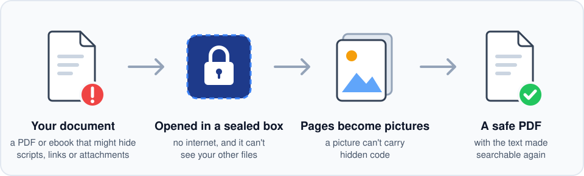
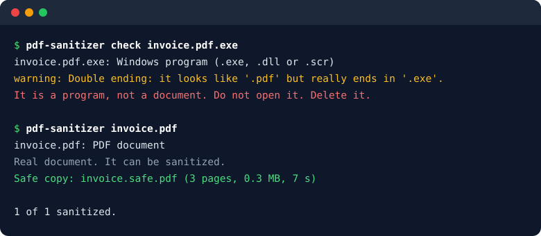

<p align="center">
  
</p>

<h1 align="center">pdf-sanitizer</h1>

<p align="center">Turn a PDF or ebook you don't trust into a safe PDF you can open.</p>

<p align="center">
  
</p>

Free ebooks and email attachments can hide scripts, links and attached programs that run when you open them. pdf-sanitizer opens the document for you inside a sealed Docker container with no internet and no access to your files. It draws every page as a picture, then builds a new PDF from those pictures and adds the text back with OCR, so you can still search and copy it. A picture of a page can't carry code, so nothing hidden in the original makes it into the copy.

Before it opens anything, it checks what the file really is. A program dressed up as a document, such as `invoice.pdf.exe`, is refused.

It reads PDF, EPUB, MOBI, FB2 and CBZ files. Read [docs/security.md](docs/security.md) for what it protects against and what it doesn't.

## Getting started

You need Docker and Python 3.10 or newer. The host side uses only the standard library, so there is nothing to install with pip.

```
git clone https://github.com/weilok2021/pdf-sanitizer.git
cd pdf-sanitizer
./pdf-sanitizer setup
```

`setup` builds the sandbox image. It is the only step that needs the internet.

On Windows, run it inside WSL with Docker Desktop's WSL integration turned on. Your Downloads folder is at `/mnt/c/Users/<you>/Downloads`.

To run `pdf-sanitizer` from any folder, link it onto your `PATH`:

```
ln -s "$PWD/pdf-sanitizer" ~/.local/bin/pdf-sanitizer
```

## Usage

<p align="center">
  
</p>

```
pdf-sanitizer check invoice.pdf       # say what the file really is; opens nothing
pdf-sanitizer invoice.pdf             # writes invoice.safe.pdf next to it
pdf-sanitizer -o ~/Safe *.pdf *.epub  # many files, saved to another folder
```

Run `pdf-sanitizer --help` for the options: picture sharpness (`--dpi`), skipping OCR (`--no-ocr`), the timeout, and so on. Ctrl+C stops a run and cleans up its containers and any half-written file.

OCR is the slow part. A 100-page EPUB takes about a minute on a 12-core PC, and `--no-ocr` is about five times faster. The safe copy is usually several times bigger than the original.

On Windows, `./pdf-sanitizer install-menu` adds **Open with → pdf-sanitizer** and **Send to → Sanitize document** to the File Explorer right-click menu, so you can sanitize files without a terminal. See [docs/windows.md](docs/windows.md).

## Formats

PDF, EPUB and MOBI are tested on real files. FB2 and CBZ open in the same reader but haven't been tested on real files yet. AZW3 (newer Kindle books), DjVu and Office documents aren't supported, and the tool refuses them with a message saying so.

## Limitations

The safe copy is a stack of page pictures. You lose fillable form fields, digital signatures, clickable links, the table of contents and text reflow. The searchable text comes from OCR, so it can misread a character; check numbers against the picture before you copy them. Password-protected PDFs are refused.

The sealed box is a Docker container and nothing more. A bug in Docker or the Linux kernel could let an attack escape it. A second layer, such as gVisor, isn't there yet.

## Development

```
python3 -m unittest discover -s tests -t .
```

The tests in `tests/test_sandbox.py` need Docker and a built sandbox. They check the container's restrictions, run a PDF and an EPUB packed with scripts, links, attachments and forms through the tool and confirm none of it survives, and feed the host a fake hijacked reader that sends oversized pages, terminal escape codes, or nothing at all.

`container/render.py` is the only code that ever reads the untrusted file.

## License

[AGPL-3.0](LICENSE). PyMuPDF, which runs inside the sandbox, uses the same license.
